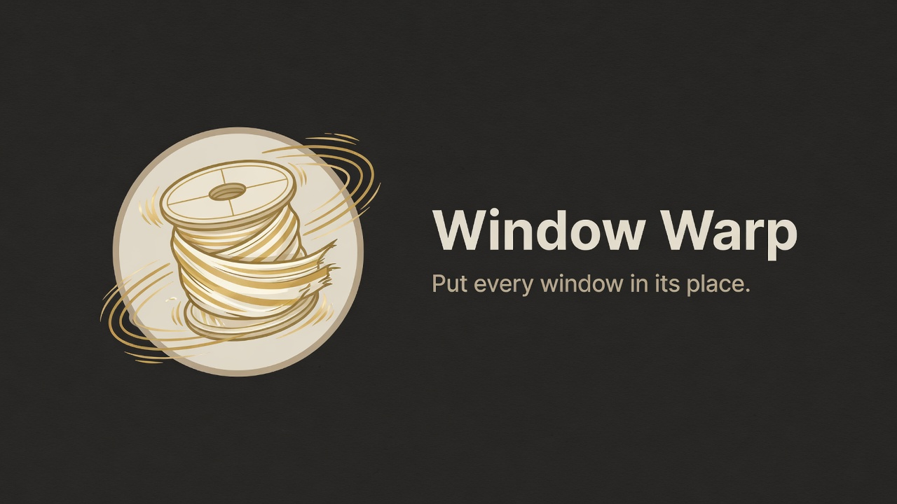

# Window Warp

Put every window in its place. Window Warp is a Windows and KDE Plasma app for moving windows between monitors, tiling them, pulling an app forward, and restoring a whole workspace.

The app lives in [`desktop/`](desktop/README.md). It does not need AutoHotkey.

## Install

Download the installers from the [latest release](https://github.com/Ryushe/windows_warp/releases/latest).

Windows: run `Window.Warp_0.1.0_x64-setup.exe`. It installs for your account and adds a Start menu entry.

KDE package: Ubuntu/Kubuntu 24.04 amd64, Plasma 5.27.11 on Wayland:

```sh
sudo apt install ./Window.Warp_0.1.0_amd64.deb
```

Run this from the download directory. `apt` installs the local `.deb` and resolves its dependencies. `sudo dpkg -i ./Window.Warp_0.1.0_amd64.deb` also works when those dependencies are already installed.

This package requires `kwin-common (= 4:5.27.11-0ubuntu3)`. Other KWin versions, including Plasma 6, need a matching companion and package build.

## What it does

- Push the focused window to the next monitor. On one monitor, Win+X tiles left and Win+C tiles right.
- After a push, press X or C within one second to tile that window.
- Pull the last pushed window back.
- Tile left, right, top, or bottom, or maximize and restore.
- Bring an app to the main monitor. If it is already there, switch back to the previous app or move it to the second monitor.
- Hold an app shortcut to tile from the pointer, or to open a radial window picker.
- Save workspaces, including window positions, Firefox tabs, and terminal sessions, then open them again.
- Edit every shortcut. Record the key, then turn Super, Ctrl, Alt, and Shift on with buttons.
- Pause from the app, the tray, or a shortcut. Closing the window keeps Warp in the tray.

## Using it

Open Window Warp and turn shortcuts on, or use the tray menu. The editor has three pages:

- **Shortcuts.** One row per chord. Open a row to change it.
- **Workspaces.** Capture what is open, then open that layout later.
- **Settings.** Theme, monitors, hold behavior, sign-in startup, and AutoHotkey import.

Themes are Warp, Dracula, Ink, Light, or a custom palette. Custom CSS is under Appearance.

Win+B opens a small editor for the app you are in. Press the new key, then Enter.

## Default shortcuts

| Shortcut | Action |
| --- | --- |
| Win+X / Win+C | Move the focused window left or right |
| Win+Ctrl+X / Win+Ctrl+C | Move it, and center the pointer |
| Win+R | Pull the last window back |
| Win+B | Edit this app's shortcut |
| Win+O | Browse workspaces |
| Win+Y | Capture a workspace update |
| Win+; | Pause or resume |
| Win+Z | Maximize or restore |
| Win+Q | Close the window |

New installs also include app shortcuts from the old AutoHotkey setup, such as Win+D for Discord and Win+S for Firefox. Every key can be changed.

## AutoHotkey

The original scripts are in [`autohotkey/`](autohotkey/) for reference. Run `autohotkey/Windows Warp.ahk` with AutoHotkey v2. Stop that script before enabling the same keys in the desktop app.

Imported settings come from `window_manager_apps.ini`, `hotkey_registry.ini`, and `windows_warp_settings.ini` in that folder. The import panel in Settings reads them. Nothing is saved until you save the draft.
